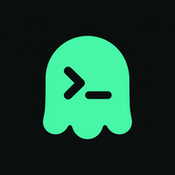
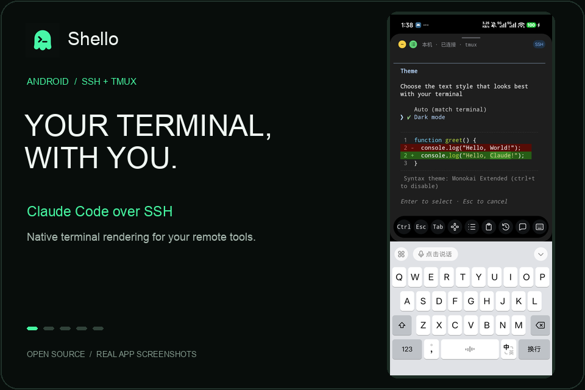

<p align="center">
  
</p>
<h1 align="center">Shello</h1>
<p align="center"><strong>把远端终端，放进口袋。</strong></p>
<p align="center">Android 原生终端 · SSH + tmux · 扫码配对 · Claude Code / Codex 会话</p>
<p align="center">
  <a href="https://github.com/JackCaow/Shello/releases">下载 APK</a> ·
  <a href="#快速配对">快速配对</a> ·
  <a href="docs/DEVELOPMENT.md">构建与接入</a> ·
  <a href="README.md">English</a>
</p>

<p align="center">
  
</p>
<p align="center"><sub>在 Shello 中通过 SSH 运行 Claude Code。</sub></p>

Shello 是开源 Android SSH 终端，使用 **Ghostty VT 内核与 Android 原生绘制**。从手机连接自己的电脑或服务器，使用 shell、Vim、less 和远端 CLI；通过 tmux 保留远端工作现场，也可查找并恢复 Claude Code / Codex 历史会话。

项目同时提供可嵌入的终端库。当前处于 **Alpha** 阶段，API 和交互仍在完善。

## 下载与安装

| 项目 | 说明 |
| --- | --- |
| 当前预发布版 | [v0.1.0-alpha06](https://github.com/JackCaow/Shello/releases/tag/v0.1.0-alpha06) |
| APK | [下载 Shello · arm64-v8a](https://github.com/JackCaow/Shello/releases/download/v0.1.0-alpha06/Shello-0.1.0-alpha06-arm64-v8a.apk) |
| Android 要求 | Android 8.1 / API 27 及以上 |
| 处理器 | 仅 arm64-v8a；不提供 32 位 ARM 或 x86 包 |
| 完整性校验 | [SHA256SUMS](https://github.com/JackCaow/Shello/releases/download/v0.1.0-alpha06/SHA256SUMS) |
| 后续版本 | [全部 Releases](https://github.com/JackCaow/Shello/releases) |

下载 APK 后在手机上打开，按系统提示允许本次安装。正式发布签名与早期调试版不同，**不能直接覆盖旧调试版**；卸载会清除本地连接和凭据，请勿为升级而直接卸载仍有重要数据的开发版。详见[签名与升级说明](docs/RELEASING.md)。

## 能做什么

- **SSH 连接**：密码或私钥认证、服务器指纹确认、已保存连接编辑、局域网 SSH 发现。
- **扫码配对**：电脑运行一条命令，手机扫码安装 SSH 公钥，随后验证连接。
- **持续会话**：借助 tmux 恢复远端 shell / Vim 会话，支持自动重连与后台连接服务。
- **触屏终端**：中文 IME、文本选择、滚动、方向浮板和 Ctrl / Esc / Tab 快捷键。
- **会话首页**：缩略图、长按排序与关闭；预览保存在本地，重启后可以恢复。
- **远端智能体**：按项目查看 Claude Code / Codex 最近会话；Claude Code / Codex Hook 支持事件与审批收件箱。
- **界面语言**：英文与简体中文，支持跟随系统或在设置中单独切换。
- **外观设置**：Shello / 黑色 / 浅色主题、字体大小与工具栏配置。

## 快速配对

### 1. 准备电脑

手机和电脑应在同一局域网，或能直接访问彼此的网络。电脑需要：

- macOS 或 Linux，已开启 SSH 服务；macOS 可开启“远程登录”。
- Python **3.9+**、OpenSSL、tmux，以及用于下载脚本的 curl。
- 允许手机访问 SSH 端口与配对服务的临时 HTTPS 端口。

以之后用于 SSH 登录的普通用户运行命令，不需要 `sudo`。脚本不会替你开启 SSH 或安装系统软件；部分 Linux 系统还需要安装 `python3-venv`。

### 2. 运行配对脚本

```sh
curl -fsSL https://raw.githubusercontent.com/JackCaow/Shello/main/companion/pair.sh | bash
```

脚本会在 `~/.local/share/shello/pair` 准备独立 Python 环境、安装二维码依赖，然后在电脑终端显示二维码。默认有效期为 **3 分钟**，保持终端打开。

<details>
<summary>指定 IP、SSH 端口或固定脚本版本</summary>

多网卡、VPN 或自定义 SSH 端口时，可以指定电脑的局域网 IPv4 地址：

```sh
curl -fsSL https://raw.githubusercontent.com/JackCaow/Shello/main/companion/pair.sh \
  | bash -s -- --host 192.168.1.10 --ssh-port 2222
```

需要固定配对服务端口以配置防火墙时，再追加 `--port 8765`。这里的 `192.168.1.10`、`2222`、`8765` 均为示例，请替换为自己的配置。

使用与当前 APK 对应的固定版本：

```sh
curl -fsSL https://raw.githubusercontent.com/JackCaow/Shello/v0.1.0-alpha06/companion/pair.sh | bash
```

查看全部参数：

```sh
curl -fsSL https://raw.githubusercontent.com/JackCaow/Shello/main/companion/pair.sh | bash -s -- --help
```

</details>

### 3. 手机扫码

1. 打开 Shello，点击 **+ → 扫码轻松配对**。
2. 允许相机权限，扫描自己电脑终端里的二维码。
3. 确认电脑地址，等待公钥安装、SSH 指纹及 tmux 验证完成。
4. 连接保存后，选择远端 tmux 会话，或创建新会话开始使用。

手机生成并保存私钥，电脑只接收公钥；已有 `authorized_keys` 条目会保留。二维码携带临时令牌，不要公开分享。配对完成后可用 **Ctrl+C** 关闭临时服务，已安装的 SSH 公钥会保留。[配对协议与更多说明](docs/HOME_AND_AGENTS.md#pairing)

### Tailscale（main 分支）

当前源码已支持 Tailscale 自动发现和二维码配对；已发布的 alpha06 APK 仍仅支持局域网配对。此功能需安装更新后的构建；alpha06 请使用对应 tag 的脚本，或给新脚本传入 `--network lan`。

两端连接 Tailscale 后，main 分支脚本默认优先选择电脑的 Tailscale IPv4 地址。配对页可选择 **自动 / 局域网 / Tailscale**，也可向脚本传入 `--network tailscale` 或 `--network lan`。访问规则需允许 SSH 与临时 HTTPS 配对端口。

自动发现结合 VPN 中明确的设备路由，以及最多四条已保存、已信任 SSH 连接提供的节点列表，仅检测最多 128 个已知地址，不遍历整个网段。若 VPN 只提供聚合路由且尚无已保存连接，先扫码配对一台电脑即可。[实现与验证说明](docs/TAILSCALE.md)

## 手动连接 SSH

不使用二维码也可以连接：

1. 点击 **+ → 使用自己的 SSH**。
2. 输入主机地址、端口和用户名，或从局域网发现列表选择机器。
3. 选择密码或私钥认证；加密私钥可填写口令。
4. 核对服务器指纹，验证并保存连接。

点击已保存连接后，应用先建立 SSH 连接，再显示 **Tmux / 最近** 选择页。长按已保存连接可以编辑或删除。[详细连接流程](docs/LOCAL_SSH.md#create-a-connection-in-the-app)

## 使用 Claude Code / Codex

CLI 运行在远端电脑上，需要先在那里安装并完成登录。Shello 提供终端操作和会话入口，不附带模型服务或订阅。

- 在终端中按通常方式运行 `claude` 或 `codex`。
- 在 **最近** 中按项目查找并恢复已有智能体会话。
- Claude Code / Codex 的事件与审批收件箱需要在 **设置 → Hook** 安装或更新辅助程序，然后新开智能体会话。Codex 还需在 `/hooks` 中审核并信任 Shello 的 Hook；若已禁用 Hook，需先在 Codex 中开启。

收件箱按会话聚合，支持状态分组、搜索、智能体/主机/项目筛选、逐请求审批、归档恢复和跳转原有 tmux 终端。私有快照在重启后恢复，缓存或离线请求不可审批。用量页读取主机已登录 Claude/Codex 账号的真实额度、重置时间，并明确标记不可用或过期状态。Codex 交互式提问回复暂不支持。具体行为与验证范围见[智能体会话说明](docs/HOME_AND_AGENTS.md)。

## 常见问题

**找不到电脑或配对失败？** 先确认 SSH 已开启、用户名正确、手机与电脑网络可达。VPN、多网卡或访客 Wi-Fi 隔离可能影响访问；可用 `--host` 明确选择 IPv4 地址。二维码过期后重新运行脚本。

**锁屏或切后台后会断线吗？** 厂商省电策略可能切断 SSH。tmux 用于保留远端进程，恢复网络或重新打开 App 后尝试重新附着；电脑关机、tmux 退出后无法恢复原进程。[真机测试与限制](docs/DEVICE_RECOVERY.md)

**首页显示“暂无预览”？** 新会话需要先打开终端生成预览。之后可见终端每 5 秒、收起或切后台时保存缩略图；关闭会话会清理对应缓存。缩略图是上次画面，不表示连接仍在线。

**能在旧安卓设备上显示所有 emoji 吗？** 字形取决于系统字体；较旧 Android 可能缺少新 emoji。复杂字符、所有输入法和所有 TUI 的兼容性仍有边界，详见[验证记录](docs/VALIDATION.md)。

## 开发与开源

| 内容 | 文档 |
| --- | --- |
| 从源码构建、嵌入终端库 | [开发指南](docs/DEVELOPMENT.md) |
| 线程、输入、资源生命周期 | [API 契约](docs/API.md) |
| 测试结果与已知限制 | [验证记录](docs/VALIDATION.md) |
| APK 签名与发布 | [发布说明](docs/RELEASING.md) |
| 问题反馈 | [GitHub Issues](https://github.com/JackCaow/Shello/issues) |

`terminal` 提供 VT、原生视图与 IME 输入；`sample` 包含 Shello 的 SSH、tmux 与应用界面。库的传输层由接入方提供，**尚未发布 Maven 包**。

Shello 是使用 Ghostty 终端内核的独立项目，并非 Ghostty 官方客户端。

采用 [MIT License](LICENSE)。依赖许可证见[第三方声明](THIRD_PARTY_NOTICES.md)。
