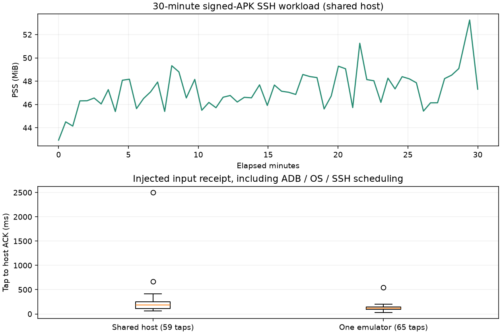

# Shello 0.1.0 release acceptance

Maintainer acceptance on 2026-10-22. The Android application is released separately from the experimental terminal-library API. No Maven package is published.

## Signed application flow

The R8-minified, release-signed APK was exercised against a disposable local macOS OpenSSH server with its own host key, authorized-key file, project, tmux socket and Hook state/configuration. Real SSH, PTY, SFTP and model CLIs were used. The helper directory was redirected into the fixture by its forced-command wrapper; personal SSH keys and existing host hooks were not modified.

- API 27: scan a QR image through the actual Android document picker, explicitly confirm the host, install the generated public key, verify pinned SSH and open a new tmux session.
- Install/update the exact bundled helper through the app's Hook page; verify merged Claude Code and Codex registrations in isolated configuration directories.
- Claude Code 2.1.306: submit Chinese/emoji text through the app's composer, receive the requested model reply, and see the same last-turn prompt/reply in the inbox. A real PermissionRequest was approved with Allow once in the app; only the requested marker command executed.
- Upload a test document with the real Files picker and SFTP. Verify exact bytes, file mode 0600 and directory mode 0700 on the host. Attaching did not send input; explicit Send submitted the path and prompt. Claude read the uploaded file and returned its marker.
- Codex 0.163.0: use the normal `/hooks` review UI, submit Chinese/emoji text through the app and receive the requested model reply. The inbox displayed the correct provider and last-turn reply.
- Vim: enter insert mode, type literal English keys, return to normal mode, then retain an unsaved Chinese/emoji buffer through actual network loss/recovery, background/screen lock, landscape recreation and process death. After ordinary launcher reopening without instrumentation, the app saved the exact UTF-8 buffer and verified the original shell environment. See [network recovery](network-recovery.json) and [process recovery](process-recovery.json).

The QR path above uses a saved image, not a claim of fresh camera-optics acceptance. Emulator host networking is local virtual networking, not new physical Wi-Fi/cellular or OEM power-policy certification. Earlier physical-device evidence remains scoped to its recorded builds.

## Input correction and regression

The API 27 Latin IME retained English letters in the hidden preedit buffer, preventing single-letter TUI actions from reaching the host. The direct editor now requests literal input without forcing ASCII. Empty composing spans also no longer swallow subsequent hardware events. Confirmed Unicode commits retain the same path.

The final R8 APK passed actual Trime/luna_pinyin key taps with no instrumentation or input-type override: `zhongwen` remained uncommitted, choosing 中文 sent it once, and cancelling the next preedit preserved already committed remote text. [Result](pinyin.json). A third-party Trime 3.3.12 `PreeditDelegate` BadTokenException occurred during an earlier IME/window transition; the steady-window run passed. This is not certification of all IMEs or Trime lifecycle stability.

- [API 27 application regression](api27-app.txt): 42 checks, including themes, settings, runtime input, preview cache and inbox model/UI.
- [API 27 terminal regression](api27-core.txt): 30 checks, including stream/lifecycle, Unicode, selection, colors, cursor, keyboard protocol and empty-composition cancellation.
- [Host helper tests](host-tests.txt): 24 isolated tests.
- [Release workflow tests](release-tests.txt): 6 tests.
- [Pairing launcher](pair-tests.txt): 2 tests, including actual pinned HTTPS and temporary public-key installation.

API 35 also passed [42 application checks](api35-app.txt) and [30 terminal checks](api35-core.txt). The terminal test APK now targets API 35 so the Android 15 deprecated-target warning cannot intercept UI tests; the library still imposes no target SDK on consumers. [Consolidated acceptance](acceptance.json) records the final gates. The publication workflow independently rebuilds, lints, signs and publishes only the APK, launcher, checksums and certificate details.

## Upgrade, runtime and data boundaries

Upgrade verification starts from the public release-signed alpha08 APK with an actual saved connection, theme/font settings and a cached terminal thumbnail. Existing file hashes are compared before launching the replacement, then the stored encrypted credentials must reconnect to the original shell and environment. Synthetic disposable-AVD data is used. The exact final APK preserved all nine existing files byte-for-byte before launch, then reconnected using the encrypted credentials to the same shell; the cached preview, light theme and 16sp font remained intact. See [upgrade result](upgrade.json). The development phone received no installation or UI actions; its last available comparison retained all 46 existing files unchanged. It disconnected afterwards. See [phone comparison](phone-data.json).

Runtime measurements use a continuously visible terminal with Unicode/ANSI output over real SSH, bounded scrollback and recurring app Send taps acknowledged by the host. Process PSS/native/Java allocations and Android gfxinfo are sampled. Tap-to-host acknowledgment includes ADB/OS/SSH/filesystem scheduling; it is not input-to-display, physical-keyboard or battery performance. Host virtualization and instrumentation overhead are included.

Drafts and staged attachments remain service-lifetime state; they are not promised across process death. Uploaded files are not automatically deleted from the host. Physical USB/Bluetooth keyboard hotplug, dead keys and OS-level shortcuts remain experimental. No overnight physical-device battery certification is claimed.

## Thirty-minute runtime result

The final signed APK rendered 77,249 Unicode/ANSI lines during 1,800 seconds of load. The sampler ran 1,830 seconds including its completion grace, with 59 samples. PSS ranged from 42.94 to 53.25 MiB; the second-half median delta was +0.94 MiB PSS and +18 KiB native allocation. No app crash or input timeout was recorded. This bounded run does not prove absence of leaks. [Summary](runtime.json), [samples](runtime-samples.json).

Tap-to-host ACK was p50 186 ms, p95 412 ms, maximum 2,502 ms while other emulator regressions and builds shared the host. Android gfxinfo reported 82,302 frames, p50/p95/p99 16/32/65 ms and 21.98% janky frames. This exposes an emulator/shared-host performance limitation; it is not a claim of uniformly smooth physical-device rendering. [Raw frame counters](runtime-gfxinfo.txt).

A follow-up with only one emulator and no concurrent Android builds/regression suites sampled 65 Send taps under the same Unicode/ANSI load: p50 120 ms, p95 167 ms, maximum 548 ms, zero timeouts. This is consistent with shared-host contention contributing to the long-run spike, but does not establish its sole cause. [Isolated measurement](isolated-latency.json), [samples](isolated-latency-samples.json).

